# Booklet

**A content management system that feels like an open book.** Booklet is built with Laravel and Livewire. Your content can live in plain text files (no database server needed) or in a database, and the admin is laid out like a book: every chapter is a sticker flag and every edit is a stamp in the margin.

It comes with **Stacy**, an assistant who can find, write, tidy and publish with you, using whichever AI service you choose.

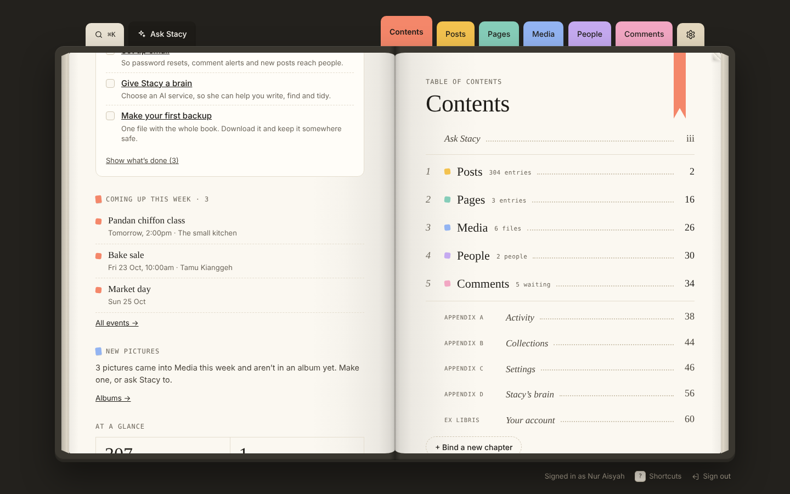

---

## What's inside

### Writing and publishing
- **Posts and pages** with drafts, scheduling, autosave, and a review step for writers before an editor publishes.
- **Proof copies:** a private link to a draft for someone without an account (a client, a friend, the person in the story). They read it exactly as the site will show it, pick out words, and leave notes that come back to the editor's margin. Links close on their own after 3 days, a week or a month, or when you stop them.
- **Search & sharing, built in:** on every post and page, see how it will look as a Google result and when its link is shared on Facebook or WhatsApp, live as you type. Write its own search title and description, with letter counts, and get gentle notes about:
  - a title that gets cut off, or no description of its own;
  - two pages with the same title;
  - pictures with no description (alt text);
  - shares with no photo.
- **Editions:** every save is kept. Compare any two side by side and put back a single field.
- **Blocks ("cut-outs"):** quotes, pictures, galleries, buttons, two columns, videos, notes and featured posts, tucked into any page and dragged into order. Inserts can add their own.
- **Linked entries and rows:** point a page at other posts and pages (with "linked from" on the other side), or keep small tables like ingredients and opening hours.
- **Show this field when…:** fields that appear only when another field says so, set up by picking or by typing it in plain words.
- **Calendar, categories and tags, redirects, and a print-ready book** of your writing.

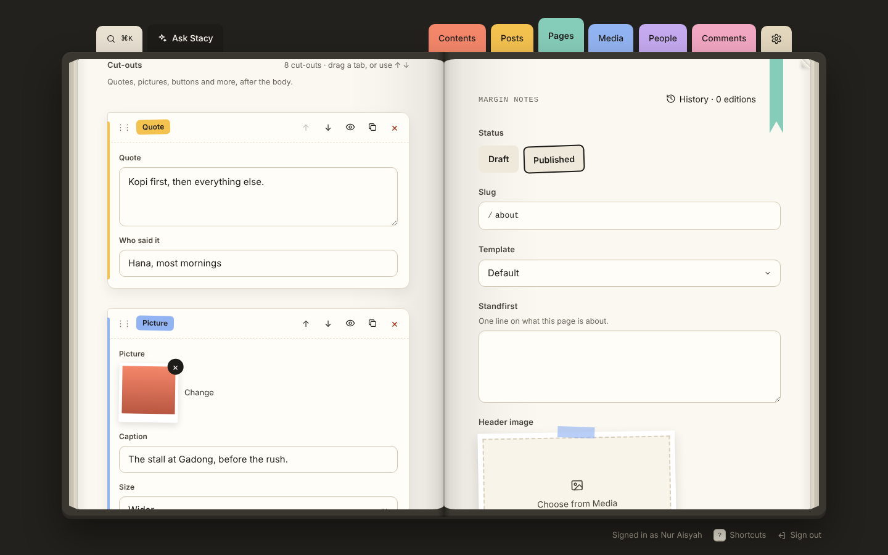

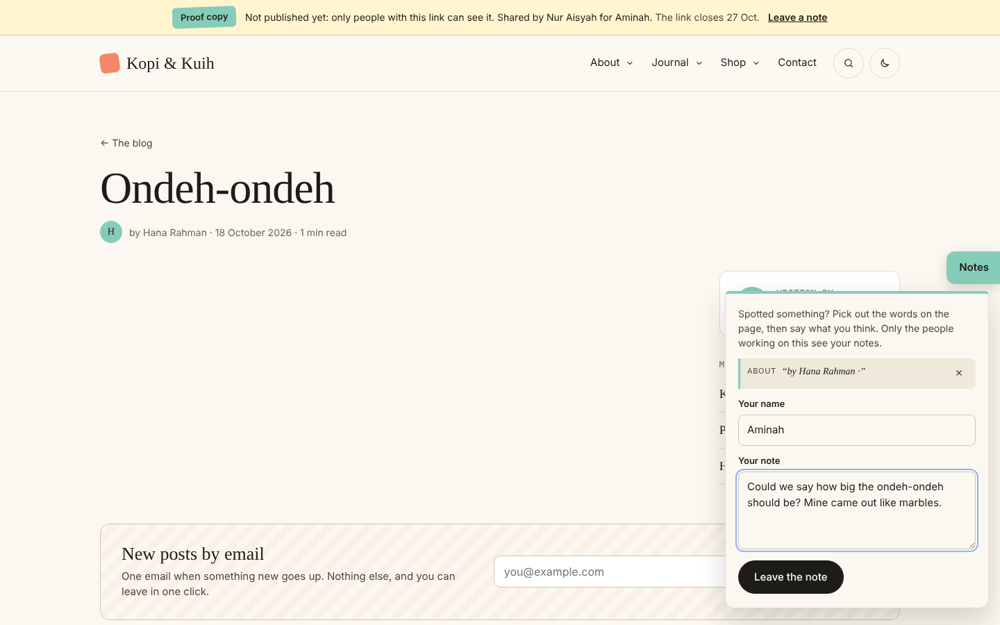

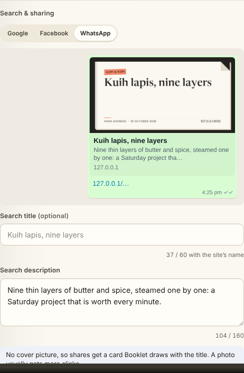

### Site menus
- **One list, drag and drop.** Rows tucked in under another drop down from it on the site, up to three levels. No mouse? Arrow keys on a row's grip do the same, and Undo takes back the last 20 moves.
- **Sub-pages that follow.** Tell a menu page to bring its sub-pages along, and new pages under it in Pages show up by themselves.
- **Wide panels (mega menus).** A top item can open a panel across the page: its links in columns, with a picture, a few words and the newest posts if you like.
- **Live preview.** Your home page wearing the unsaved menu, wide or phone-sized, seen only by you until you save.
- **Arrange it in words.** Type “put Shop first and tuck Prints under it”, “move Contact after About” or “rename Journal to Notes”. It works without any AI, and Undo takes it back. Stacy understands the same words (`/menu …`) and asks “Yes?” before saving.
- **Menu check-up.** Rows that point at a deleted or draft page, at an address with nothing there, or a wide panel with nothing in it are marked in the list. A menu bar too long for smaller screens is flagged too, and so is anything readers would trip over in the check-up.
- **Seasonal menus.** Make a version of a menu for set dates (a Raya menu, a year-end sale). It takes over by itself on its first day and steps back after its last, in the site's own time zone.
- On the site, drop-downs work with a mouse, a keyboard (Escape closes them) and on phones, where they open in place. The footer menu shows its links in groups.

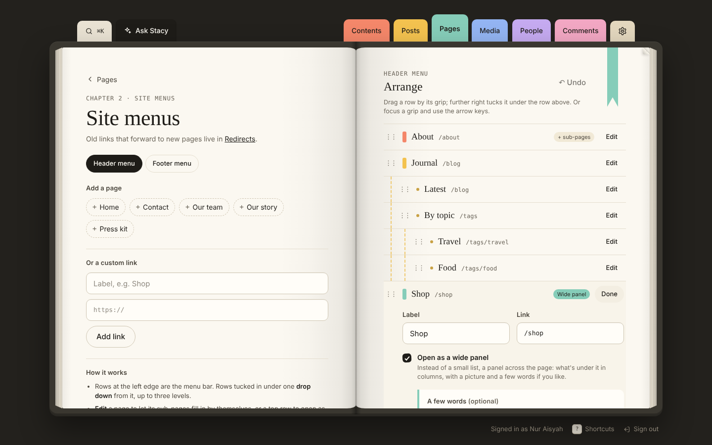

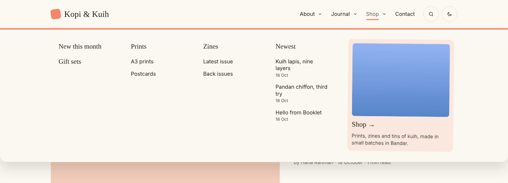

### Your site, your way
- **The cover:** the site's look chosen from five presets (Notebook, Broadsheet, Kopitiam, Botanic, Studio), then changed bit by bit: fonts for titles and for menus, the accent colour, the paper, how the header and the home page are laid out, corners and tilted stickers. A live preview, wide or phone-sized, shows it before anyone else sees it. No CSS needed.
- **Themes:** find themes on GitHub without leaving The cover (search, newest or most starred, with what you already have and newer versions marked), or add one from a .zip, a link or a GitHub repository. **Cover packs** bring their own fonts, colours, presets and settings (a wave under the masthead, round pictures…) and are safe to add from anyone: Booklet reads their styles through first. **Themes with templates** change the pages themselves; they're code, so adding one asks for your password. Either way, Booklet's own pieces (menus, comments, share cards, search-engine data) come along, and a broken template never reaches readers: they get Booklet's own page, and The cover says what broke. **Harbour**, a cover pack, comes with Booklet. Making one: `php booklet make-theme`, and [`themes/README.md`](themes/README.md). **Sharing one** (a theme or an insert): a step-by-step guide right beside it, with a checked .zip to download and the GitHub steps filled in. Searches are kept for half an hour; GitHub answers 60 an hour for a server without a token, and many more with one (`BOOKLET_GITHUB_TOKEN` in `.env`, read-only access to public repositories is enough).
- **Publish as plain files:** one button turns the public site into ordinary web pages, pictures and styles, for GitHub Pages, Netlify or any host that serves files (no PHP needed there). With GitHub connected, they go to the `gh-pages` branch, and Booklet can publish again by itself a couple of minutes after you stop making changes. Search still works, in the reader's browser.
- **Content API:** your published posts and pages as JSON, for an app or another website. Keys are made in Settings and can be switched off one at a time, or the API can be opened to everyone. Read-only, and drafts never leave.

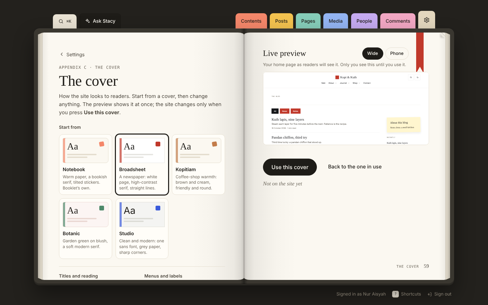

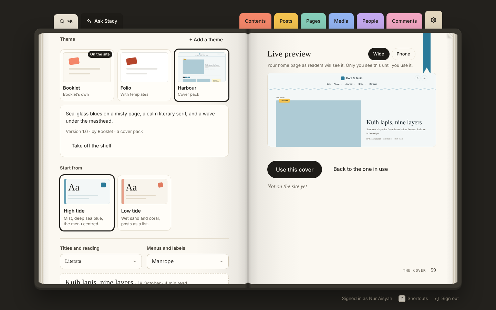

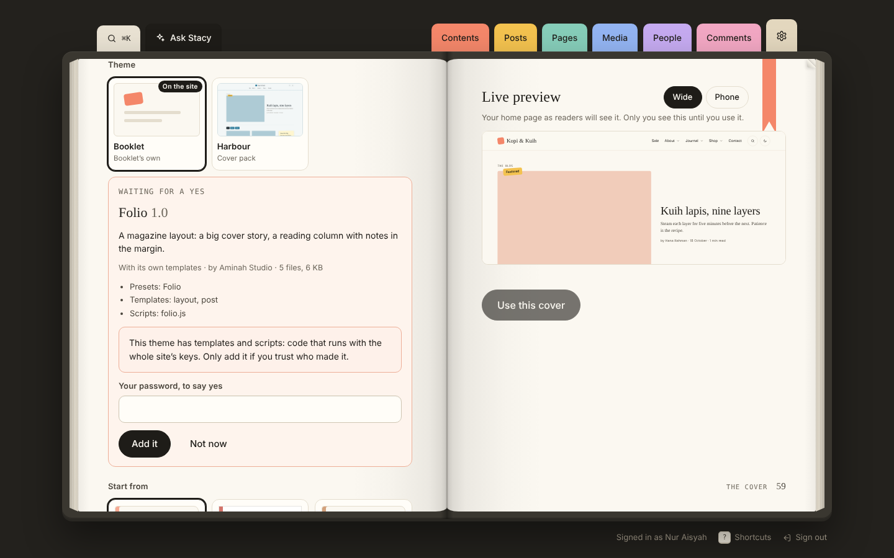

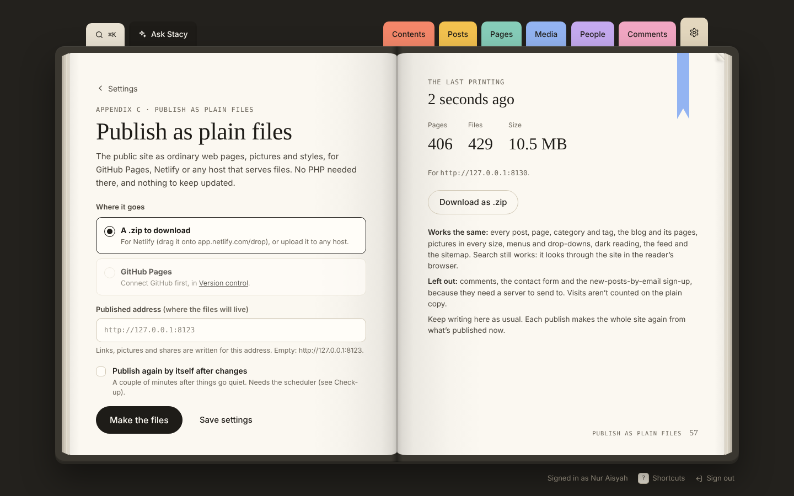

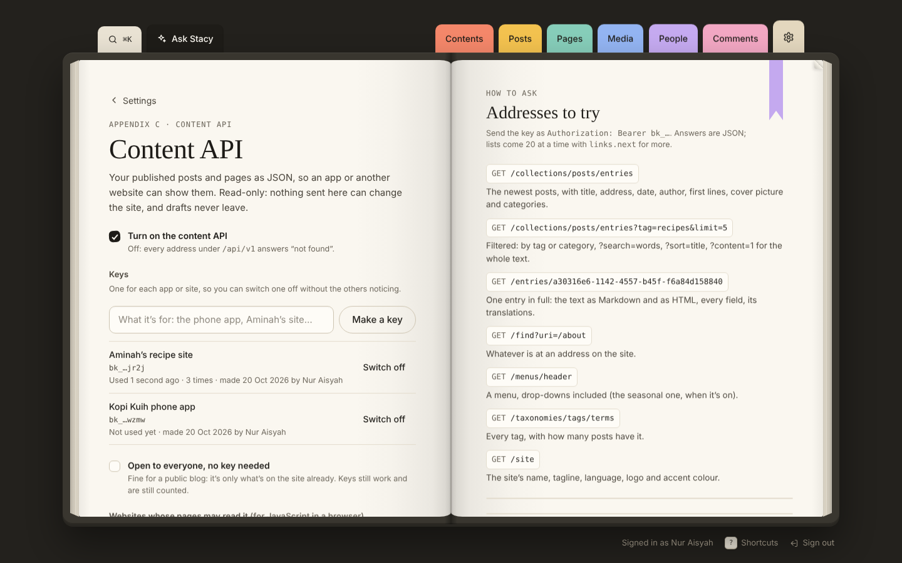

### Make it yours

Everyone who writes in Booklet can set it up their own way, from Your account › Make it yours. Nobody else is affected.

- **How it opens:** the Book (two pages, stickers, page turning) or a plain Dashboard: a top bar, a sidebar with sub-menus that folds to a slim rail, white panels, and each chapter as a table you can sort, filter and tick to change many at once.
- **Theme:** Paper, Linen, Mist or Rose, plus Night reading (on, off, or following the device).
- **Fonts:** six pairs, including Easy reading (Atkinson Hyperlegible).
- **Spacing and text size**, and whether pages turn between chapters.
- **Your menu:** drag them into your own order; move each chapter and tool onto the stickers, the side tabs, only the Index, or hide it; rename and recolour them; pick the two chapters on the phone's bar. Only what someone may open is ever listed.

### Collections and blueprints
- Make your own chapters (collections) with their own fields, described in blueprints: simple YAML files you can read and edit by hand.
- Field types: text, rich text, long text, number, date, image, toggle, select, tags, link, blocks, linked entries and rows.

### Media
- Uploads with focal points, alt text and folders.
- **Picture sizes:** Card, Hero, Square, Tall and Share (or your own), cut around each picture's focal point and served as WebP.
- Smaller copies for every picture, so phones download small ones.

### People and roles
- Admins, editors and writers, plus **library cards**: custom roles that act like a writer or an editor and then open or close each chapter, Media and Stacy.
- Admins can **see the book as any card** before giving it to someone.
- Two-step sign-in, signed-in devices, and a gentle activity log.

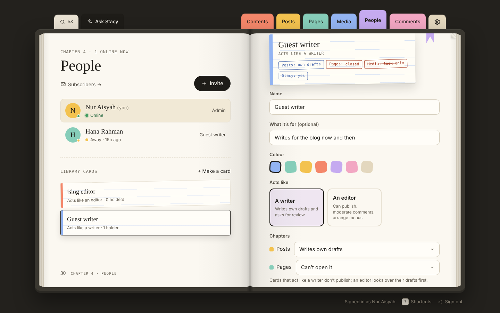

### Readers and groups
- **Accounts for your readers** on the public site: join, confirm their email, sign in, forgotten password, and their own page (details, password, groups, new posts by email, delete the account). Readers are kept apart from the people who write: a reader's account can never open the admin.
- **How people join:** anyone, anyone who asks (you let them in), by invitation only, or nobody new. Invite someone by email from **People › Readers & groups**.
- **Groups**: "Members", "Kuih Club", "Staff". Readers and people from the book can be in several. Each group is open, by request, by invitation link, or added by you.
- **Members-only posts and pages:** in the editor, *Who can read it*: everyone, signed-in readers, or some groups. Everyone else sees the title, first lines and a way in; search, feeds, the content API and the plain-file copy leave the rest out. Page-builder sections can be shown only to signed-in readers or only to people who aren't.
- **Make it yours:** extra sign-up questions, the words on the pages, a line in the welcome email, where readers land after signing in, and the "Sign in" button in the top bar. The pages live under `/members` (change it with `BOOKLET_READERS_PATH`), and a theme can replace any of them: `site/readers/*.blade.php` and `site/locked.blade.php`.

### Stacy, the assistant
- Ask in words: find entries, list drafts, give a daily brief, check the book, schedule or publish (always asking "Yes?" first).
- Writing help in the editor: tighten, simplify, warm up, fix or keep writing the selected words.
- Translations into a new draft, a weekly letter, and a spoken voice if you'd like one.
- Works with Claude (Anthropic), OpenAI, Google Gemini, Groq, OpenRouter, Ollama on your own computer, or any OpenAI-compatible service. You choose the model.

### Readers
- A warm, fast public site: blog, pages, search, RSS, a sitemap, structured data for search engines, and dark reading.
- Comments with moderation and reply alerts, a contact form with an inbox, and new posts by email to subscribers.
- Visits counted without cookies, with "read to the end" for each post.

### Keeping it safe
See [Security](#security) for how Booklet protects your data, sign-ins and uploads.
- **Backups:** the whole book in one file, nightly if you like, and restored with a look inside first.
- **Version control:** with content kept as files, every change is committed to git on its own, credited to whoever made it. You can browse the history and put the whole book back to any point. **Send it to GitHub in three steps** from the same page, no commands needed. Booklet won't commit files with unfinished merge marks, and it offers to take private files out of git if any were committed before.
- **Check-up:** a page (and `php booklet doctor`) that tells you what the server is missing and how to fix it.
- **Upkeep:** clear caches, prepare the site for speed, remake every picture, tidy how posts and pages are written (you see each change first), show readers a "back soon" page while you work, and **start again**: clear the parts you choose (posts and pages, media, people, readers, settings, connected services, records) or everything, as a new install. A backup is always made first. All of it is in Settings › Upkeep and on the command line, `php booklet`.
- A bin that keeps deleted things for 30 days.

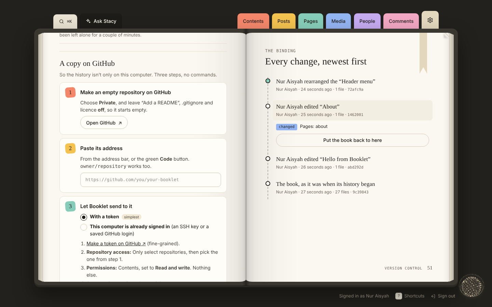

### Inserts
Find them on GitHub from Settings › Inserts › Add, the same way as themes. Small add-ons that live in `inserts/`: they can add pages to the admin, cards on Contents, `[[slips]]` in writing, cut-outs, scheduled jobs, new skills for Stacy, and checks on the site's forms. **Events**, **Gallery** and **Guard** are inserts of their own, each in its own repository, so they're kept up to date like any other: add them from Settings › Inserts › Add. **Guard** keeps robots out of the comment, contact and new-posts forms (and sign-in, if you like) with Cloudflare Turnstile, Google reCAPTCHA or hCaptcha, turns away words and addresses you list, and keeps a log of what it stopped. Add more from a .zip, a link or a GitHub repository in Settings › Inserts. See [`inserts/README.md`](inserts/README.md).

---

## Requirements

- **PHP 8.3 or newer** with the `gd` (with WebP), `zip`, `pdo_sqlite` (or your database's driver), `mbstring` and `fileinfo` extensions
- **Composer**
- A database: **SQLite** works out of the box and is what Booklet is tested on (Laravel's other databases should work too)
- **Git**, only if you want version control

Built on Laravel 13 and Livewire 4.

## Getting started

```bash
git clone https://github.com/<you>/booklet.git
cd booklet

composer install
cp .env.example .env
php booklet key:generate

touch database/database.sqlite
php booklet migrate
php booklet storage:link

php booklet serve
```

Then open **http://localhost:8000**. The first visit takes you to a short setup: your site's name, your colour, and the first admin account.

### On shared hosting (no terminal)

Download the ready-made `booklet-x.y.zip` from the [releases](https://github.com/ClownS9/BookletCMS/releases) (it has everything, the `vendor` folder included), then:

1. Upload what's inside it to your host. Best: point your domain at Booklet's `public` folder. If you can't, upload it into your main folder (`public_html`, say); Booklet's `.htaccess` sends visitors to `public` so its own files are never reachable.
2. Open your site. Booklet checks the server (PHP version, extensions, folders it needs to write to) and says how to fix anything missing.
3. Choose where Booklet keeps things: a database file (nothing to set up), or a MySQL/MariaDB database from your hosting panel. Booklet writes its settings file (`.env`, with a new secret key), makes the tables, and takes you to the short setup above.

Hosts that don't allow the `public/storage` link still work: Booklet hands out uploaded files itself. Add the scheduler (below) from your panel's “Cron jobs” page when you can.

### Updating

When a new version is out, admins see it on the contents page and in **Settings › Updates**, with what changed. **Update** makes a backup of the book, downloads the release, checks it against GitHub's fingerprint and that it's whole, then swaps Booklet's own files (keeping the old ones) and updates the database. Your posts, uploads, settings, `.env` and themes you added aren't touched. If anything goes wrong it goes back by itself, and **Go back** undoes an update afterwards.

A copy kept with git is updated with git instead (`git pull`, `composer install`, `php booklet migrate`). New versions come from `BOOKLET_UPDATES_REPO` (default `ClownS9/BookletCMS`); `BOOKLET_UPDATES_CHECK=false` stops the daily look.

**Making a release:** `composer install --no-dev --optimize-autoloader`, raise `version` in `config/booklet.php`, run `php booklet package`, and attach the .zip it makes to a GitHub release tagged with that version, with what changed in the release notes.

### Keep content as files (recommended)

Booklet can keep content in a database or as **flat files**: plain text files on disk instead of database tables. A flat-file setup needs no database server for content at all.

- **Posts and pages** are Markdown files (`.md`), with their details (title, date, tags…) in a YAML header at the top.
- **Everything else** (categories and tags, menus, settings, blueprints, forms) is YAML (`.yaml`).
- They live in `content/` and `resources/` (`blueprints`, `fieldsets`, `forms`), one file per item, so you can open them in any text editor.

Files are easy to read, back up and keep in git. People, comments, form replies and visit counts always stay in the app's database (SQLite by default). In `.env`:

```dotenv
BOOKLET_DRIVER=file
```

Each kind of content can also be set on its own (`BOOKLET_ENTRIES_DRIVER`, `BOOKLET_TERMS_DRIVER`, …). To move existing content across, use `php booklet export` (database → files) or `php booklet import` (files → database).

### Let it run on its own

Scheduled posts, nightly backups, emails to subscribers, link checks, version control and publishing plain files again after changes all need Laravel's scheduler. Run it every minute, for example with cron:

```cron
* * * * * cd /path/to/booklet && php booklet schedule:run >> /dev/null 2>&1
```

The check-up (Settings › Check-up) tells you if it isn't running.

### Email

Out of the box, emails are written to the log (`MAIL_MAILER=log`). Set up a real mail server in **Settings › Email** so password resets, reply alerts and new posts reach people.

### Give Stacy a brain

In **Settings › Stacy's brain**, pick an AI service and paste its key, or point her at Ollama running on your own computer. Keys stay on your server and are never included in backups.

## Useful commands

Booklet has its own command line, `php booklet`. Run it on its own to see every command, grouped; `php booklet help <command>` explains one. Anything Laravel offers works through it too (`php booklet migrate`), and `php artisan booklet:<command>` still works for scripts written before.

| Command | What it does |
| --- | --- |
| `php booklet` | List Booklet's commands (`php booklet list --all` for everything) |
| `php booklet doctor` | The check-up, in the terminal |
| `php booklet cache:clear` | Clear kept pages, compiled templates and cached settings. Booklet's own notes (link reports, updates, sign-in steps) are kept |
| `php booklet optimize` | Prepare settings, routes and templates ahead, for a live server |
| `php booklet down "Back by six"` / `up` | Show readers a calm "back soon" page (`--for=60` to come back by itself), and let them back in. Everyone signed in keeps working |
| `php booklet tidy` | Look at what tidying the writing would change (stray spaces, empty lines, invisible characters, skipped heading levels); `--apply` to do it, `--only=` to choose. Code is left alone and each earlier version stays in History |
| `php booklet backup` / `restore` | Make a backup, or restore one |
| `php booklet export` / `import` | Move content between the database and files |
| `php booklet git-commit` | Commit content changes to git now |
| `php booklet import-wordpress` | Move in from a WordPress export |
| `php booklet pictures` | Make (or `--clear`) the smaller copies of pictures |
| `php booklet pictures:rebuild` | Throw away every picture's smaller copies and crops, and make them again |
| `php booklet links` | Check every link in published posts and pages |
| `php booklet pages-clear` | Make every cached page fresh |
| `php booklet insert-install` / `insert-update` / `insert-undo` | Add, update or roll back an insert |
| `php booklet send-posts` | Send new posts to subscribers now |
| `php booklet package` | Pack Booklet into the .zip people install and update from |
| `php booklet share` | Pack a theme or insert into a .zip to share, checked as Booklet checks one being added |
| `php booklet make-theme` | Make a theme in `themes/` to change (`--templates` to start from Booklet's templates) |
| `php booklet publish-static` | Make the site as plain files (`--send` to GitHub Pages, `--address=` for where they'll live) |
| `php booklet reset` | Start again: choose what goes (`--only=content,media,people,readers,settings,connections,records`), or `--everything` to empty the book for First setup, like a new install. Always backs up first and asks you to type the site's name |

Most of these are also in **Settings › Upkeep**, which shows when each last ran.

## Content API

Turn it on in **Settings › Content API** and make a key. Then:

```bash
curl https://yoursite.com/api/v1/collections/posts/entries?limit=3 \
  -H "Authorization: Bearer bk_your_key"
```

| Address | What comes back |
| --- | --- |
| `/api/v1/site` | The site's name, tagline, language, logo and accent colour |
| `/api/v1/collections` | Each collection, and how many published entries it has |
| `/api/v1/collections/{collection}/entries` | Published entries, 20 at a time. `?tag=`, `?category=`, `?search=`, `?sort=title` (or `date`, `-date`, `order`), `?limit=` (up to 100), `?page=`, `?language=`, `?content=1` for the whole text |
| `/api/v1/entries/{id}` | One entry in full: the text as Markdown and HTML, its cover, terms, other fields and translations |
| `/api/v1/find?uri=/about` | Whatever is at an address on the site |
| `/api/v1/menus/{handle}` | A menu with its drop-downs (the seasonal one, when it's on) |
| `/api/v1/taxonomies/{taxonomy}/terms` | Every category or tag, with how many posts have it |

Lists carry `meta` (total, page, last page) and `links.next`. Each key gets 120 requests a minute (`X-RateLimit-Remaining` says how many are left), and asking for the same thing twice with `If-None-Match` gets a `304`.

## Version control settings

Switch it on in **Settings › Version control**, or in `.env`.

### Sending it to GitHub, without the command line

Under **A copy on GitHub** in the same page, three steps:

1. **Make an empty repository on GitHub** (the button opens GitHub's page). Choose Private, and leave README, .gitignore and licence off.
2. **Paste its address** (`https://github.com/you/repo`, the SSH address, or just `you/repo`).
3. **Let Booklet send to it** with a fine-grained token made for that one repository, with *Contents: Read and write*. Or use the computer's own GitHub sign-in (an SSH key or a saved login).

Then **Connect and send**. From then on, every commit is sent there too.

- **The token** is kept encrypted with your `APP_KEY` in `storage/app/private`. It's only ever handed to git while sending, never written into `.git/config`, and never shown again. The Mac Keychain prompt stays out of it.
- **When something goes wrong,** the page explains it in plain words (expired token, wrong address, no internet), with the fix.
- **If GitHub already has other commits** (a README made there, or an older history), Booklet asks before doing anything. You can replace GitHub's copy with this book, or use a different, empty repository. It never merges the two by itself.
- **Before anything is sent,** Booklet checks for:
  - private files git kept from before (`.env`, the database, `storage/booklet`), with a button to take them out of git and keep them on disk;
  - files with unfinished merge marks (`<<<<<<<`). Those are never committed, and the check-up names any content file that can't be read.

### In `.env`

```dotenv
BOOKLET_GIT=true          # commit changes on their own
BOOKLET_GIT_PUSH=false    # send them to the remote too
BOOKLET_GIT_REMOTE=origin
BOOKLET_GIT_PATH=         # another repository (default: this project)
```

By default only `content/`, `resources/blueprints`, `resources/fieldsets` and `resources/forms` are committed (and Media, if you ask). Switch on **Commit everything, not just content** to have the whole project committed too, code and README included. `.env`, the database file, `vendor/`, `node_modules/`, logs, backups, and Booklet's own revisions and form submissions (`storage/booklet/`) are never committed either way.

## Security

### Your data and the database

- **Two places, clearly split.** Content (posts, pages, settings, blueprints) lives in flat files or in the database, whichever you choose. Accounts, comments, form replies, sessions and the activity log always live in the app's database (SQLite by default, a single file in `database/`).
- **Nothing private is reachable from the web.** Only `public/` is served. The database file, `content/`, `resources/`, `storage/` and `.env` sit outside it.
- **Passwords are never stored**, only bcrypt hashes. New passwords must reach a "Fair" strength or better: common passwords, your own name or email, and runs like `1234` count for almost nothing, while long passphrases do well. The meter in the browser and the check on the server use the same rules.
- **Secrets are encrypted at rest.** AI service keys, the mail server password, and two-step sign-in secrets and recovery codes are encrypted with your `APP_KEY` before they're saved. If the key ever changes, they read as empty and Booklet asks for them again, instead of breaking.
- **Safe database access.** All queries go through Laravel's query builder and Eloquent, with bound parameters, never raw values pasted into SQL.
- **Backups leave secrets out.** AI keys and the mail password are never put in a backup file. Everything else is, so keep backups somewhere private.
- **Version control never commits secrets.** `.env` files, the database file, `vendor/`, logs and backups are left out even if `.gitignore` forgets them.
- **Proof copy links are private by design.** Only a fingerprint (SHA-256) of each link's secret is looked up. The pages tell search engines to stay away, aren't cached or counted as visits, and never pass the link on to other sites. Notes are rate-limited and screened for robots, and every link closes by itself.
- **The GitHub token is kept like a secret.** It's encrypted with `APP_KEY`, only handed to git while sending, and never written into `.git/config` or shown again. Make it a fine-grained token for that one repository, with nothing but *Contents: Read and write*.
- **Revisions and form submissions stay on the server.** `storage/booklet/` has its own `.gitignore` (put back if it goes missing), so even a hand-typed `git add .` leaves them out. Your content's history is in git already, through `content/`.
- **Content API keys are kept as fingerprints.** A key is shown once when it's made; after that Booklet keeps only its SHA-256 fingerprint and last four letters. The API is off until an admin turns it on, only ever reads, and only answers with what readers can already see. Browsers on other websites can read it only if their website is listed in Settings (Laravel's own CORS default, which would let any site read `/api/*`, is turned off).
- **Plain files carry nothing private.** Only pages a visitor could open are made; forms that need a server are left out.
- **Tests can't touch your content.** They always run against an in-memory database and refuse to start otherwise, and keep their working files (plain-file builds, API settings) in a folder of their own.

### Signing in

- **Passkeys:** Face ID, Touch ID, Windows Hello, a phone or a security key instead of a password (and instead of the code). Your account › Signing in has an *Is this device ready for passkeys?* check that says what's missing.
- **Two-step sign-in** with any authenticator app (six-digit codes that change every 30 seconds), plus single-use recovery codes. A code can't be used twice.
- **Slowed-down guessing:** five wrong passwords or codes in a row and that email (from that address) has to wait. Password reset requests are limited too.
- **"Was this you?" emails** when a password, email address or two-step setting changes.
- **Signed-in devices:** see where you're signed in, and sign out one device, every other device, or everywhere.
- Sessions are renewed at every sign-in, and admin pages are never cached by the browser.

### Who can do what

- **Roles:** admins, editors, writers and custom "library cards", checked on the server for every action, not only hidden in the interface.
- Writers only edit their own drafts and can't publish. Changing settings, people, backups and inserts is for admins only.
- **Stacy asks first.** She only proposes changes (publish, edit, delete a comment…) and nothing happens until the person presses "Yes". She can only do what that person's role allows.

### What visitors send and what gets uploaded

- **Writing is cleaned:** raw HTML in posts and pages is stripped and unsafe links (`javascript:` and the like) are removed. Comments and messages are always shown as plain text.
- **Uploads are checked by their contents, not their names.** A file is saved with the extension its bytes really have, so a picture renamed `page.html` can't be served as a web page. SVG pictures are stripped of scripts, event handlers and outside references.
- **Fetching from other websites** (pictures in a WordPress import, inserts from a link) only goes to public addresses over http(s). Addresses inside your own network are refused, at every redirect, and there's a size limit.
- **Spam:** comments and contact messages full of links are held for a person to look at, and contact messages sent faster than a person could type are set aside.
- Links in emails can't be guessed: "stop telling me about replies" links are **signed**, and unsubscribe links carry a long random token. Forms are protected against cross-site requests (CSRF), and public forms are rate-limited.

### On every page

Booklet sends security headers: `X-Content-Type-Options: nosniff`, `X-Frame-Options: SAMEORIGIN`, a strict `Referrer-Policy`, a `Permissions-Policy` that turns off camera, location and payments, `Cross-Origin-Opener-Policy`, and `Strict-Transport-Security` once the site is on HTTPS.

### Inserts

Inserts are code, and they run with the same access as Booklet itself. Booklet:
- reads an insert's details without running it;
- checks a .zip for unsafe file names, symlinks and code that doesn't parse;
- asks for the admin's password again before adding one;
- keeps the previous version, so an update can be undone.

**Only add inserts from people you trust.**

An insert's secret settings (another service's key, like Guard's CAPTCHA secret) are encrypted with `APP_KEY`, never sent to the browser, and left out of backups. Guard's sign-in protection only starts once its keys have worked on its own page, and a wrong key never locks anyone out; if anything goes wrong, `BOOKLET_SAFE_MODE=true` switches every insert off.

### Themes

A **cover pack** can only change how the site looks, so it's safe from anyone. Before one is added, Booklet:
- allows only theme.json, a README or license, and styles, fonts and pictures in `assets/`;
- reads its styles through: nothing from other websites, no `@import`, none of the old ways to run script from CSS (escapes are read as what they stand for first);
- cleans its SVG pictures of anything that runs, and serves them so a browser won't run anything in them anyway;
- never serves a script from it, even if one is there.

A **theme with templates** is code, like an insert: it asks for the admin's password, its templates must be for the public site only (never the admin), and each is checked for mistakes before it's added. Its scripts only run on the public site. If one of its templates breaks, readers get Booklet's own page, and safe mode (`BOOKLET_SAFE_MODE=true`) wears every theme as a cover pack. The copy an update replaces is kept, so it can be undone.

**Only add themes with templates from people you trust.**

#### Trying passkeys on your own computer

Browsers only make passkeys on an address that is secure and has a name:

- **Quickest:** `php booklet serve`, then open **http://localhost:8000**. `localhost` counts as secure. `127.0.0.1` doesn't work: it's numbers, not a name.
- **A local name** such as `booklet.test`: give it https. With Laravel Herd, `herd secure booklet`; with Valet, `valet secure booklet`; otherwise make a certificate with [mkcert](https://github.com/FiloSottile/mkcert). Then set `APP_URL=https://booklet.test`.
- Avoid a real domain name (like `booklet.com`) pointed at your own computer over plain http: it isn't secure, so the browser says no.
- **Touch ID on a Mac:** a fingerprint added in System Settings › Touch ID & Password. Safari and Chrome both use it; the passkey is kept in your iCloud Keychain (Safari) or Chrome's password manager.
- Behind a proxy that handles https (Cloudflare, a load balancer), add `TRUSTED_PROXIES=*` to `.env` (or the proxy's addresses), or the server sees plain http and turns the passkey away.

### Before going live

- [ ] `APP_ENV=production` and `APP_DEBUG=false` in `.env`. The check-up warns if debug is on in production.
- [ ] Serve the site over **HTTPS**, set `APP_URL` to the `https://` address, and set `SESSION_SECURE_COOKIE=true`.
- [ ] Point your web server's document root at `public/`, never at the project folder.
- [ ] Keep `APP_KEY` safe and the same. It encrypts the saved secrets above, and changing it means entering them again.
- [ ] Turn on two-step sign-in for every admin.
- [ ] Make sure only the web server's user can read `.env`, the database file and `storage/`.
- [ ] Run the scheduler, so nightly backups happen, and download a backup now and then.
- [ ] Open **Settings › Check-up** (or run `php booklet doctor`) and fix anything it lists.
- [ ] Keep dependencies up to date with `composer update`.

### Reporting a problem

If you find a security issue, please report it privately through GitHub's **Security › Report a vulnerability** on this repository rather than in a public issue.

## Tests

```bash
php booklet test
```

Tests always run against an in-memory database and never touch your real content.

## Project layout

```
app/Booklet/      content repositories, stores, the page tree and menus, and the Booklet facade
app/Livewire/     the admin (Admin/) and the site's interactive parts (Site/)
app/Stacy/        the assistant: chat, tools, providers, voice
app/Support/      blocks, links, rows, crops, version control, backups, health…
content/          content as files (when BOOKLET_DRIVER=file)
inserts/          add-ons you add or make (each its own folder)
themes/           how the site looks: Harbour, and your own (see themes/README.md)
resources/views/  admin, site and email templates
public/booklet/   the admin's and site's styles and scripts
```

## License

MIT.
